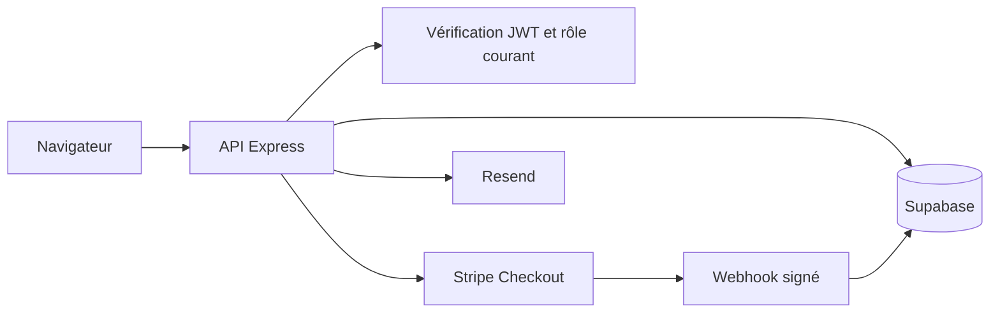

# Étude de cas

## Du besoin au contrôle

Un espace client et une administration ne peuvent pas faire confiance aux prix,
rôles ou statuts renvoyés par le navigateur. Le travail sur SerenityWeb a amené
à contrôler ces informations côté serveur et à documenter leurs limites.

Ce schéma présente les responsabilités du service privé, pas un inventaire de
ses adresses, tables ou secrets. Les exemples du dépôt isolent certains contrôles
pour pouvoir tester sans connexion aux prestataires.

| Risque étudié | Réponse illustrée | Limite du laboratoire |
| --- | --- | --- |
| Réutilisation d'un code | Expiration, consommation unique, nombre d'essais limité | Stockage mémoire, pas de contrôle distribué des demandes |
| Code utilisé dans un autre parcours | HMAC lié à l'identité et à l'usage | La distribution du code et la récupération du compte restent hors périmètre |
| Ancien rôle encore présent dans une session | Lecture du rôle et de la version actuels | Les claims doivent être authentifiés avant l'appel |
| Prix changé dans le navigateur | Montant canonique côté serveur, calcul en centimes | Pas de fiscalité ni de règle commerciale complète |
| Événement rejoué | Identifiant déjà traité et état de la commande | En production, contrainte unique et transaction atomique nécessaires |

## Ce qui a été adapté pour cette publication

Les contrôles sont reformulés en fonctions indépendantes, avec des exemples
synthétiques. La répartition en centimes n'est pas la reproduction du tarif
commercial de SerenityWeb. Le journal de paiement mémoire est volontairement un
double de test : il ne garantit ni la persistance ni la concurrence entre serveurs.

## Vérification et honnêteté

La CI exécute les tests présents, pas un audit de toute l'application. Elle ne
valide pas la configuration de production, une conformité réglementaire ou
l'absence de vulnérabilités. La signature JWT, la signature du corps brut Stripe,
la protection contre l'abus de demandes et la rotation des secrets sont des
responsabilités d'intégration à traiter séparément.

